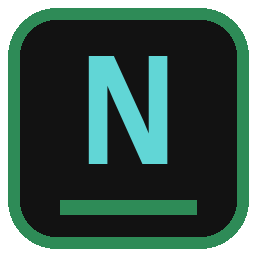
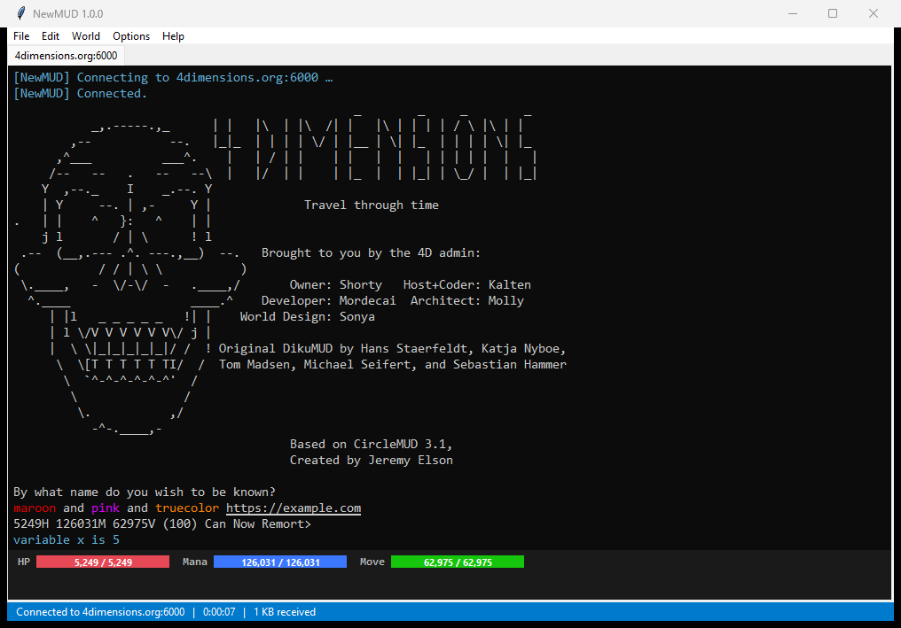

<p align="center"></p>

<h1 align="center">NewMUD</h1>

<p align="center">A free, open-source MUD client for Windows, made in the spirit of the classic <b>GMud</b>.<br>
Simple like the old days, with full color and the modern features today's MUDs need.</p>



## Why?

GMud was a much-loved, simple MUD client, but it hasn't been updated since the 1990s. Modern MUDs send
256-color and true-color codes that GMud can't show, so you get garbage like `[38;5;160m` in the middle of
your text. NewMUD is written from scratch (it contains no GMud code) to keep that simple
one-window feel and work properly with today's MUDs.

## Features

**The GMud classics**
- Separate input and output windows, command history, local echo
- Triggers, aliases and F-key macros
- Speedwalking (`.3n2e`) and command stacking (`north;open door;east`)
- Logging to a file, copy-on-select, scrollback
- **Import your GMud worlds, triggers and macros** straight from `WorldLis.mud`

**New in NewMUD**
- 🎨 **Full color**: 16, 256 (xterm) and 24-bit true color, plus clickable web links
- 🗂️ **Tabs**: play several MUDs (or characters) at once; tabs light up when there's activity
- 📜 **Split-screen scrollback**: scroll up to read history while new text keeps coming below
- ❤️ **HP / Mana / Move bars** read from your prompt (configurable with a regex for any MUD)
- 🔔 Triggers can **highlight** text in a color, **gag** (hide) spam lines, or **play a sound**
- ⏱️ **Timers** that send commands every N seconds
- 🔢 **Numpad walking** (8/2/4/6 = n/s/w/e, 9/3 = up/down, 5 = look)
- `#var` **variables** (`#var target goblin` then `kill @target`), `#5 bash` repeat
- Tab-completion of words on screen, history search (Ctrl+↑)
- Find in scrollback (Ctrl+F), save the session as a colored **HTML** page
- MCCP compression, NAWS window size, password hiding, auto-reconnect
- Portable: one `.exe`, settings saved in a readable JSON file next to it

## Download & run

1. Grab **`NewMUD.exe`** from the [Releases](../../releases) page.
2. Put it in any folder (e.g. next to your old GMud), then double-click it.
3. Pick a world in **File → Worlds** (Ctrl+O), or use **Quick connect**.

If NewMUD finds GMud's `WorldLis.mud` in the same folder (or the folder above), it offers to import it.
You can also use **File → Import from GMud…** any time.

> Windows may show a SmartScreen warning the first time because the exe isn't code-signed.
> Click *More info → Run anyway*, or run from source (below).

Command line, like GMud: `NewMUD.exe mud.example.com 4000` or `NewMUD.exe "World name"`.

## Quick guide

| Type this | What it does |
|---|---|
| `north;get all;look` | several commands at once |
| `.3n2e` | speedwalk: north ×3, east ×2 |
| `#5 bash` | repeat a command 5 times |
| `#var target goblin` → `kill @target` | variables |
| `\raw text` | send text exactly as typed (no aliases) |
| `#connect` `#disconnect` `#reconnect` `#log` `#clear` `#help` | client commands |

**Keys:** ↑/↓ history · Ctrl+↑ search history · Tab complete · PageUp / mouse wheel opens the scrollback
split · Esc closes it · Ctrl+F find · Ctrl+Tab next tab · Ctrl+W close tab · middle-click a tab to close it.

**Aliases**: `k` → `kill %1` (%1..%9 are the words after it, %* all of them; with no `%`, the words are appended).

**Triggers** match each line from the MUD as *contains*, *wildcard* (`*` and `?` capture `%1`, `%2`…),
*regex* or *exact*. They can send commands, highlight, gag or play a `.wav`.

**Gauges** use a regex on your prompt. The defaults read prompts like `5249H 126031M 62975V`. Set a
*max regex* if your prompt shows maximums (e.g. `\d+/(\d+)hp`), otherwise the bar uses the highest value seen.

## Run from source

Requires Python 3.9+ (Tkinter is included with the standard Windows installer). No other packages.

```bash
python NewMUD.pyw
```

Run the tests:

```bash
python -m unittest discover -s tests
```

Build the single-file exe (installs PyInstaller):

```bash
build.bat
```

## Contributing

Bug reports and pull requests are welcome, especially from fellow GMud fans who remember a feature
we're missing. Please include the MUD name and a log snippet when reporting display problems.

## License

[MIT](LICENSE). NewMUD is an independent project and isn't affiliated with GMud or its authors.
